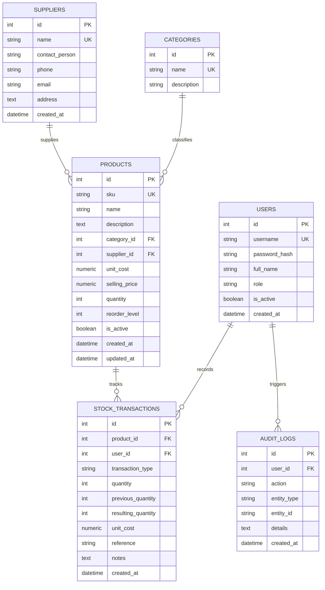

# StockPulse — Inventory and Stock Analysis System

A modern, full-stack Python web application designed for enterprise inventory tracking, stock movements, and analytics.

Built with **Python 3, Flask, SQLAlchemy, Pandas, SQLite, Bootstrap 5, and Chart.js**.

---

## 1. Project Abstract

In wholesale, manufacturing, and retail businesses, inaccurate stock tracking leads to costly stockouts, capital lockup in slow-moving goods, and audit discrepancies. **StockPulse** is a centralized inventory management and intelligence platform. It tracks product records, automates inbound and outbound stock transactions, provides reconciliation workflows, and analyzes inventory health using Pandas. The system incorporates Role-Based Access Control (RBAC) separating administrative privileges from operational staff duties.

---

## 2. Problem Statement

Traditional stock registers and disconnected spreadsheets suffer from:
1. **Concurrency and Integrity Errors:** Human errors, double-counting, and negative inventory states.
2. **Lack of Auditability:** Missing attribution for stock issues, adjustments, and receipts.
3. **No Real-time Analytical Intelligence:** Absence of automated replenishment alerts, turnover velocity tracking, and stock-flow visualization.
4. **Security Vulnerabilities:** Weak role separation and exposure to formula injection in spreadsheet exports.

---

## 3. Key Features

### Role-Based Access Control (RBAC)
- **Administrator:** Full system control, user management, category and supplier configuration, product catalog administration, stock adjustments, and audit log inspection.
- **Warehouse Staff:** Restricted access to inventory catalog searching, recording authorized stock receipts (`STOCK_IN`), processing dispatches (`STOCK_OUT`), viewing permitted transaction history, and viewing analytics.

### Centralized Stock Service & Atomic Mutations
- All inventory modifications route through a single backend `StockService` (`app/services/stock_service.py`).
- Atomic transactions with rollback guarantee that stock levels never drift from transaction ledgers.
- Prevents negative stock, zero-quantity movements, and unauthorized adjustments.

### Analytics & Intelligence
- **Inventory Valuation:** Real-time calculation of total units, current inventory cost basis, and potential retail sales value.
- **Dynamic Stock Movement Flow:** Time-series tracking of inbound vs. outbound physical units (7D, 30D, 90D, and all-time).
- **Category Capital Allocation:** Product counts, unit distribution, and portfolio financial percentage share per category.
- **Product Velocity Rankings:** Classifies fast-moving and slow-moving SKUs based on actual dispatch velocity.
- **Transparent Reorder Recommendations:** Calculates safety buffers and purchase requirements based on daily sales velocity and supplier lead times:
  $$\text{Target Stock} = \text{Reorder Threshold} + \left(\text{Daily Run Rate} \times (\text{Target Cover Days} + \text{Lead Time Days})\right)$$
  $$\text{Suggested Order} = \max(0, \text{Target Stock} - \text{Current Stock})$$

### Reporting & Document Exports
- **Clean Vector PDF Generation:** Enterprise-grade PDF document export using ReportLab for Master Product Inventory, Categories, Low-Stock Alerts, Transaction Ledgers, Reorder Plans, and Fast-Moving item reports.
- **Dynamic Two-Pass Pagination:** Automatic "Page X of Y" footers, running headers, and table styling.
- **Filterable CSV Support & Formula Sanitization:** Built-in **CSV Formula Injection Sanitization** (CWE-1236 mitigation) escaping dangerous spreadsheet triggers (`=`, `+`, `-`, `@`).

---

## 4. Technology Stack

| Layer | Technologies |
|---|---|
| **Backend Language** | Python 3.14 / 3.11+ |
| **Web Framework** | Flask 3.1 |
| **ORM & Database** | SQLAlchemy 2.1, Flask-SQLAlchemy 3.1, SQLite 3 (Foreign Keys enforced) |
| **Authentication** | Flask-Login 0.6, Werkzeug security (PBKDF2/SHA-256 hashing) |
| **Forms & Validation** | Flask-WTF 1.3, WTForms 3.3, email-validator 2.3 |
| **PDF Generation** | ReportLab 5.1 (Professional vector PDF reports) |
| **Data Analytics** | Pandas 3.1, NumPy 2.5 |
| **Frontend Framework** | HTML5, CSS3, Bootstrap 5.3, Bootstrap Icons |
| **Data Visualization** | Chart.js 4.4 |
| **Automated Testing** | pytest 9.1, Flask Test Client (In-memory SQLite) |

---

## 5. Database Schema & Architecture



---

## 6. Directory Structure

```text
inventory-stock-analysis/
│
├── app/
│   ├── __init__.py               # Application factory & error handlers
│   ├── extensions.py             # DB, LoginManager, CSRF & SQLite PRAGMA
│   ├── forms.py                  # WTForms form validations
│   ├── utils.py                  # Access control decorators & CSV sanitizer
│   ├── seed.py                   # Deterministic dataset generator
│   │
│   ├── models/                   # SQLAlchemy Relational Models
│   │   ├── __init__.py
│   │   ├── user.py               # User authentication model
│   │   ├── category.py           # Taxonomy category model
│   │   ├── supplier.py           # Vendor supplier model
│   │   ├── product.py            # Master SKU product model
│   │   ├── stock_transaction.py  # Inventory ledger transactions
│   │   └── audit_log.py          # Regulatory audit trail
│   │
│   ├── services/                 # Centralized Business Logic
│   │   ├── __init__.py
│   │   └── stock_service.py      # Atomic inventory mutations & validations
│   │
│   ├── auth/                     # Authentication & User Management
│   │   ├── __init__.py
│   │   └── routes.py
│   │
│   ├── dashboard/                # Main Executive Dashboard
│   │   ├── __init__.py
│   │   └── routes.py
│   │
│   ├── inventory/                # Catalog, Suppliers & Stock Operations
│   │   ├── __init__.py
│   │   └── routes.py
│   │
│   ├── analytics/                # Pandas Intelligence & Predictive Reorder
│   │   ├── __init__.py
│   │   ├── routes.py
│   │   └── services.py
│   │
│   ├── reports/                  # CSV Export Endpoints
│   │   ├── __init__.py
│   │   └── routes.py
│   │
│   ├── templates/                # Jinja2 Modular Layouts
│   │   ├── base.html             # Application shell (Sidebar, Navbar)
│   │   ├── auth/                 # Login, user list, user form
│   │   ├── dashboard/            # Executive KPI & chart view
│   │   ├── inventory/            # Products, categories, stock in/out/adjust
│   │   ├── analytics/            # Intelligence breakdown & reorder plans
│   │   ├── reports/              # Export hub
│   │   └── errors/               # 403, 404, 500 error views
│   │
│   └── static/                   # Static Assets
│       ├── css/style.css         # SaaS Enterprise styling
│       └── js/
│           ├── dashboard.js      # Chart.js dashboard integration
│           └── analytics.js      # Chart.js analytics integration
│
├── tests/                        # Comprehensive Automated Test Suite
│   ├── conftest.py               # Pytest fixtures & in-memory SQLite DB
│   ├── test_auth.py              # Login, logout, RBAC permission tests
│   ├── test_inventory.py         # Product, stock-in, stock-out, rollback tests
│   ├── test_analytics.py         # KPIs, Pandas flow, rankings tests
│   └── test_reports.py           # CSV exports & formula injection tests
│
├── instance/                     # SQLite database storage (inventory.db)
├── run.py                        # Application entrypoint & CLI commands
├── seed_db.py                    # Standalone sample data loader
├── config.py                     # Configuration settings
├── requirements.txt              # Pinned Python package dependencies
├── .env.example                  # Environment variable template
└── README.md                     # Documentation & Viva guide
```

---

## 7. Installation & Setup Guide (Windows / macOS / Linux)

### Step 1: Open Terminal / PowerShell and Navigate to Project
```powershell
cd C:\Users\ganga\.gemini\antigravity\scratch\inventory-stock-analysis
```

### Step 2: Create and Activate Virtual Environment
```powershell
# Create virtual environment
python -m venv .venv

# Activate virtual environment (Windows PowerShell)
.\.venv\Scripts\Activate.ps1

# (Alternative: macOS / Linux)
# source .venv/bin/activate
```

### Step 3: Install Package Dependencies
```powershell
pip install -r requirements.txt
```

### Step 4: Configure Environment Variables
```powershell
Copy-Item .env.example .env
```

### Step 5: Populate Demo Data (Optional but Recommended for Viva)
```powershell
python seed_db.py
```

### Step 6: Start Web Server
```powershell
python run.py
```
Open your browser and navigate to: **`http://127.0.0.1:5000`**

---

## 8. Demo User Accounts

| Role | Username | Password | Permissions |
|---|---|---|---|
| **Administrator** | `admin` | `Admin123!` | Full control: Users, Catalog, Suppliers, Adjustments, Audit Logs |
| **Warehouse Staff** | `staff` | `Staff123!` | Operational: Stock-In, Stock-Out, Search Catalog, View Ledger |

*(Tip: The login page includes quick 1-click credential fill buttons for fast demonstration).*

---

## 9. Running the Automated Test Suite

Execute the full suite of 24 unit and integration tests using pytest:

```powershell
pytest -v
```

### Test Coverage Highlights:
- **Authentication & RBAC:** Verifies password hashing, session persistence, inactive user lockout, and denial of admin routes to staff.
- **Product & Catalog Integrity:** Validates unique SKU constraints, safe soft deactivations, and price validations.
- **Stock Service Operations:** Tests atomic increments, atomic decrements, negative stock prevention, insufficient stock errors, and automatic transaction ledger generation.
- **Data Analytics:** Verifies zero-record resilience, accurate cost valuation using `Decimal`, and velocity-based reorder calculations.
- **Security:** Verifies CSV formula sanitization (CWE-1236 protection).

---

## 10. College Viva & Technical Review Q&A Guide

**Q1: Why did you centralize inventory modifications in `StockService` instead of writing them directly in Flask routes?**  
*Answer:* Writing inventory mutations across multiple route handlers leads to code duplication, inconsistent validation, race conditions, and skipped audit logging. Centralizing all mutations in `StockService` guarantees that every change is validated, permissions are enforced, stock availability is confirmed before issuance, product balances and ledger records are created in a single database transaction with automatic rollback on error.

**Q2: How does the application prevent negative stock?**  
*Answer:* Two layers of protection are implemented:
1. **Application Layer (`StockService`):** Before executing `record_stock_out`, the service checks if `product.quantity < requested_quantity`. If true, it raises an `InsufficientStockError` and rolls back.
2. **Database Layer:** The `products` table defines an explicit SQL Check Constraint: `CheckConstraint("quantity >= 0", name="check_positive_quantity")`.

**Q3: Why use `Numeric(10, 2)` instead of `Float` for money and costs?**  
*Answer:* Binary floating-point arithmetic (IEEE 754) introduces precision round-off errors (e.g. `0.1 + 0.2 = 0.30000000000000004`). In financial and inventory valuation systems, `Numeric(10, 2)` maps directly to Python's `Decimal` class, guaranteeing exact arithmetic.

**Q4: How does the reorder recommendation formula work?**  
*Answer:* Rather than arbitrary guesses, it calculates the **Daily Sales Velocity** over the past 30 days. It then estimates future demand over a target coverage window (e.g., 30 days) plus supplier lead time (7 days), adding the product's safety reorder threshold:
$$\text{Target Stock} = \text{Threshold} + (\text{Velocity} \times 37)$$
If the current stock is lower than this target, the difference is recommended for replenishment. If no historical sales exist, it defaults to a threshold coverage baseline ($2 \times \text{Threshold}$).

**Q5: What is CSV Formula Injection and how is it prevented?**  
*Answer:* If a user enters a product or reference starting with symbols like `=`, `+`, `-`, or `@`, spreadsheet applications like Microsoft Excel or LibreOffice Calc will execute it as an executable macro/formula when opening the CSV. We implemented `sanitize_csv_cell()` which prepends a single apostrophe (`'`) to any dangerous leading characters, neutralizing formula execution.
